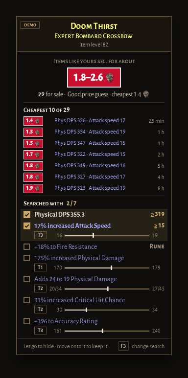
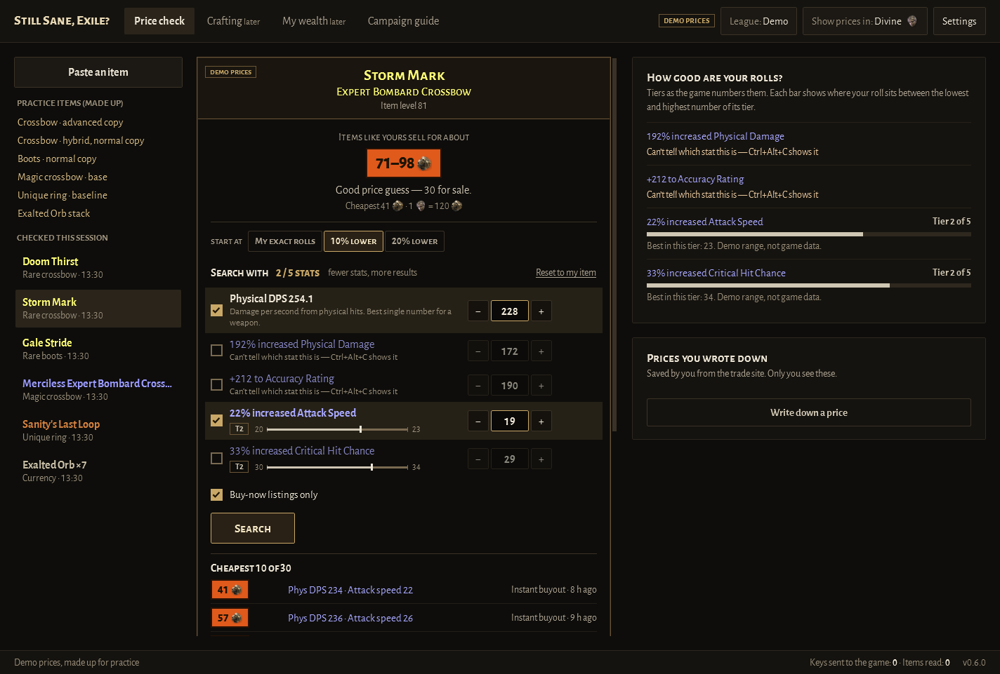

# Still Sane, Exile?

Hold `Ctrl+C` over a Path of Exile 2 item to see what items like it sell for, and exactly which of its stats that price searched with. Let go and it hides. Move the mouse onto the card while you hold, and it stays open so you can tick stats and press **Search** for the cheapest listings like it and their price. `F3` opens the full price check over the game, where you choose the stats and numbers to search for and see how good each roll is.

[Download for Windows](https://github.com/AutumnTrace/still-sane-exile/releases/latest) · [Changelog](CHANGELOG.md)

Windows 10/11 · x64 · Windowed or borderless · Game set to English (other languages get a plain "not supported yet" message)



Doom Thirst in the demo profile: items like it ask about 1.8–2.6 div, with 29 for sale. The search wanted physical DPS of at least 319 and attack speed of at least 15, 10% under its own rolls. The price is coloured like a loot filter label (white and red for a jackpot, red for Divines, orange to tan for Exalted money, dark for small change) and shows the game's own orbs instead of "div" and "ex".

## Try it on a crossbow

You don't need the game running. Run `StillSaneExile-win-Setup.exe` from the [latest release](https://github.com/AutumnTrace/still-sane-exile/releases/latest) (it installs for your user, no admin rights) or unzip `StillSaneExile-win-Portable.zip` anywhere. The build isn't code-signed yet, so SmartScreen may warn you: choose **More info → Run anyway**. Installed copies apply downloaded updates when you close the app.

On first start, pick **Practice with demo data**, then **Done — try a price check**. SSE opens Doom Thirst, a made-up crossbow.

Doom Thirst has a T1 physical damage prefix. Its 175% roll is 56% of the way through that tier's 170–179%, four short of the best. The attack-speed roll reads 17%, a third of the way through its 16–19% range. Both bars sit under **How good are your rolls?**: each shows how close a roll is to the best number in its tier; tier 1 is the best a stat can be.

All of this is demo data: made-up tiers, ranges and listings. On a live item, an advanced copy (`Ctrl+Alt+C`) gives the game's own tiers and ranges, drawn as a position marker until a verified data pack confirms which end is better. In a live league, currency, other exchange items and uniques get poe.ninja's prices for that league, with their age (see [Live prices](#live-prices)). Rares have no price list: **Search** asks the official trade site for the cheapest listings like yours (see [Trade site search](#trade-site-search)), or you open the search there and write down the asks you find. A real-game test run is still to come.

## Choose what you're comparing

[](docs/screenshots/inspect-advanced.png)

Tick what a weapon like yours must have, set the numbers, and the price follows.

Press `F3` after a peek and this price check opens over the game. Tick **Physical DPS**, step its minimum and press **Search**: the price, the count and the cheapest listings update. Changing the search alone never searches: the old result fades, marked *Search to update*, until you press it. **Open this search on the trade site** opens the official site in your browser with the same search filled in: the base, the rarity, the stats you ticked with their numbers, and instant buyout only unless you untick **Buy-now listings only**. Anything the link can't carry is listed under the button, to set by hand there. The demo's league is made up, so its links search Standard. **Copy search** copies the link and the filters as text. Asks worth keeping go under **Write down a price**.

The demo's 1.8–2.6 div runs from just above the cheapest of the 29 matching listings to the middle one: made-up asking prices, not sales or a league quote. Only instant buyout listings set the price: a seller asking without instant buyout is often unsure of it, so with **Buy-now listings only** unticked those listings show in the list but never move the price. Eight or more instant buyout prices read *Good price guess*, three to seven a *Rough price*, one or two *too few to trust*.

<details>
<summary>Why does my 192% physical roll say "Can't tell which stat this is"?</summary>

Storm Mark, the second practice crossbow, is a normal copy. It shows `192% increased Physical Damage` next to `+212 to Accuracy Rating`. A weapon can roll a pure physical damage prefix and a hybrid prefix that adds both physical damage and accuracy, and a normal copy adds them together into one line. From the total alone, more than one pair of tiers fits, so SSE doesn't guess: both lines get no bar, stay out of the starting search, and list the explanations that fit when you hover them.

An advanced copy (`Ctrl+Alt+C`) prints each affix on its own with its tier and range, which settles it. In the demo, those tiers come from the made-up data pack.

[](docs/screenshots/inspect-hybrid.png)

</details>

## What the app reads when you press a key

| Key | What it does |
|---|---|
| Hold `Ctrl+C` | Shows the card for the item under your cursor. Move the mouse onto the card to keep it open and change the search; let go without moving and it hides |
| Hold `Ctrl+Alt+C` | The same card from the game's advanced copy, with tiers and ranges |
| `Esc` or **×** | Closes a card you kept open (`Esc` once you have clicked it). Checking another item replaces it |
| `F3` | Opens the price check for your last item over the game; `Esc` closes it |

Settings can change every key, including to a side mouse button (Mouse 4 or 5), and **Press again to hide** can replace holding. A side button isn't the game's copy key, so the game copies nothing when you press it: the card shows the last item you copied with `Ctrl+C`, which may not be the one under your cursor.

The game copies the item. SSE reads the changed clipboard once for that press and draws a click-through card that doesn't take focus; releasing the key hides it. While you hold the key, SSE checks where the mouse cursor is (its position, not the screen); when the cursor reaches the card, the card starts taking clicks and stays after you let go, without another read. It never takes the focus, even when you click it, so the game keeps your keyboard; close it with its ×. Ticking stats on it reads nothing and searches nothing; its **Search** button asks the trade site, only when you click it. `F3` reopens the saved item without another read, and takes focus so you can type until you close it. SSE never sends input to the game, and a key press never makes a network request: the card shows only prices already on your computer until you press **Search**. Details: [Capture and privacy](docs/CAPTURE-AND-PRIVACY.md).

Every control in SSE works from the keyboard and has a name for screen readers, and its windows follow the Windows text size setting as far as they fit your screen. Details and contrast measurements: [Accessibility](docs/ACCESSIBILITY.md).

## Live prices

Pick a live league in Settings and confirm it: SSE offers poe.ninja's leagues (one request for the list), or you type the name. From then on, SSE asks [poe.ninja](https://poe.ninja/poe2) for that league's prices a few seconds after it starts, then every hour: exchange prices for currency, fragments, essences, runes, soul cores, idols, uncut gems, lineage supports, omens, delirium, expedition and verisium, and unique item prices. That is about 20 requests per hour, one at a time and at least 5 seconds apart, following poe.ninja's cache headers. Each request names the league, the category and SSE's version, and nothing about you, your account or your items. The last few refreshes are kept in the data folder, so prices still show offline, with their age; they are marked stale after two missed hourly refreshes.

The prices are poe.ninja's own estimates for the whole league. A unique's price is a baseline for that unique, not for your rolls. Switch **Live prices from poe.ninja** off in Settings and SSE asks poe.ninja for nothing. SSE makes two other kinds of request: the trade site search below, only when you press **Search**, and the update check against this repository's GitHub releases. Settings can switch each off.

## Trade site search

In a live league, **Search** on the card or the price check asks the official trade site for listings like your item: one search with the stats and numbers you ticked, instant buyout only unless you untick **Buy-now listings only**, cheapest first, then one request for the ten cheapest. Only when you click: a key press, a tick or a changed number never asks the site, and the demo never does (its practice items search made-up listings the same way, without the network). The requests carry the search (the item's base, rarity, stats and numbers, and your league) and SSE's version; no login, no cookies, nothing about your account. SSE keeps within the rate limits the site announces, waits when it asks (*The trade site asks to wait 30 s*), and keeps the last result meanwhile.

The price runs from the second-cheapest instant buyout listing to the middle one of those ten; the count is the site's own. The list shows each listing's price, the listed item's numbers for the stats you searched, instant buyout or in person, and how long ago it was listed, never who listed it. Switch **Search the trade site from SSE** off in Settings and Search sends nothing.

## Is it allowed?

Grinding Gear Games' [developer policy](https://www.pathofexile.com/developer/docs) permits apps that run independently from the game, and bans apps that interact with the game or its files. SSE is the permitted kind: it never touches the game's memory, files or logs, and never sends a key, click or chat message to the game. It reads the clipboard once per key press you make, as the policy requires, and tells you what each key reads. **Search** uses the trade site's search the way the site's own page does, without logging in and within the limits it announces; that search isn't part of GGG's documented developer API, so GGG may change or close it. It reads at most one frame of the game window per press of the stash key, and only while you've switched **Collect stash pictures** on.

GGG doesn't approve or guarantee any third-party tool, and its rules can change, so no tool can promise you won't be banned. SSE is built to follow the rules as written, and we recheck them before features that read more of the screen. Policy quotes and how SSE meets each one: [Sources](docs/SOURCES.md#ggg-third-party-policy-checked-27-november-2026).

## Also in the app

**My wealth** keeps count of what you hold, tab by tab, from counts you type or a [CSV file](docs/WEALTH-CSV.md). The **Campaign guide** walks the start of Act 1 (a draft route, not yet checked in game) and turns your own build notes into gem steps for the stage you are at; a pasted guide link only ever opens in your browser.

**Help build stash reading.** Path of Exile 2 has no stash API, so SSE will read your stash from a picture of the game window. To build that, switch on **Collect stash pictures** in Settings, open your stash in the game and press `Right Alt` (or your stash key) once per tab: each press saves one picture of the game window, with notes on your screen setup, in your data folder. Label them on My wealth. They are never uploaded; before you share any on [issue #3](https://github.com/AutumnTrace/still-sane-exile/issues/3), crop or blur chat and character names.

## What's next

Held-key price labels for stash and Aldur reward panels come next. Wealth history, the rest of the campaign route and crafting plans follow; see the [roadmap](docs/ROADMAP.md). Players can help with two open issues: [English item copies to check the parser against](https://github.com/AutumnTrace/still-sane-exile/issues/1) and [how the card behaves on your screen](https://github.com/AutumnTrace/still-sane-exile/issues/5). Item text and measurements are enough; leave out account names and stash screenshots.

## Build from source

You need Windows 10 or 11 (x64) and the [.NET 10 SDK](https://dotnet.microsoft.com/download).

```powershell
git clone https://github.com/AutumnTrace/still-sane-exile.git
cd still-sane-exile
dotnet run --project src/StillSaneExile.Desktop
```

Run the tests:

```powershell
dotnet test
```

Add `-- --data <empty folder>` for a clean profile. `src/StillSaneExile.Domain` owns parsing, pricing and the comparison rules, plus the market client's rules (rate limits, cache, poe.ninja's and the trade site's answers), with no Windows code and no connection of its own: the app hands it the `HttpClient`. `src/StillSaneExile.Desktop` owns WPF, foreground detection, clipboard access and the hourly price schedule. See also [data sources and coverage](docs/SOURCES.md), [cutting a release](docs/RELEASING.md) and [third-party licences](docs/THIRD-PARTY.md).

Path of Exile and Path of Exile 2 are trademarks of Grinding Gear Games. This product isn't affiliated with or endorsed by Grinding Gear Games in any way.
