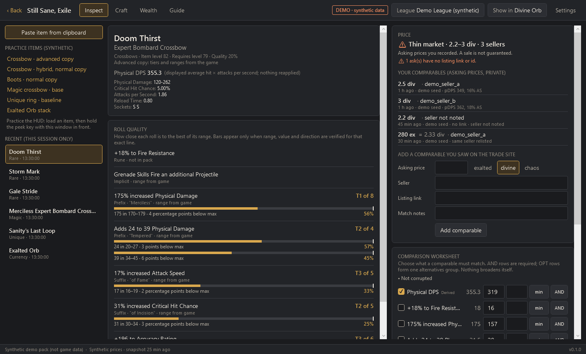

# Still Sane, Exile

A Path of Exile 2 companion for Windows. Hover an item, hold a key, and see which rolls are good and what comparable items ask. Later milestones add held-key price labels on stash and Aldur reward panels, crafting plans, wealth history and campaign guidance (SSE for short).

> This product isn't affiliated with or endorsed by Grinding Gear Games in any way.



## Status: v0.1.0 (Milestone 1 foundation, demo-first)

| Area | State in this version |
|---|---|
| **Item peek HUD** | Works. Hold `Ctrl+C` over an item in game: the game copies it, SSE reads that copy once and shows a click-through card until you release. |
| **Inspector** | Works. Roll bars, tiers, hybrid ambiguity, physical DPS, every line kept with its source. |
| **Comparison worksheet** | Works. Presets, AND/optional groups, double-count warnings, one-step relaxations, official trade-site handoff. |
| **Manual comparables** | Work. Private asks you record, summarized as median / thin market / one ask. |
| **Demo profile** | Works. Synthetic items, ranges, prices and listings, labelled DEMO everywhere. |
| **Live prices** | Not yet. Shared poe.ninja / GGG exchange cache is Milestone 2. A live profile says "no market data". |
| **Verified game data pack** | Not yet. Live roll bars use advanced-copy ranges only, shown as position markers until directions are verified. |
| **Stash and Aldur labels** | Not yet (Milestone 2). The key is reserved and nothing reads the screen. |
| **Wealth / Guide / Craft** | Not yet (Milestones 3, 4, 5). Each page says what is planned. |
| **Installer and auto-update** | Works. Velopack installer and portable zip on every release; installed copies update themselves from GitHub releases. |
| **Real-game validation** | Not done. Item text, overlay placement and DPI behaviour are tested on synthetic fixtures and this machine only; see [docs/SOURCES.md](docs/SOURCES.md). |

## Install

1. Download **`StillSaneExile-win-Setup.exe`** from the [latest release](https://github.com/AutumnTrace/still-sane-exile/releases/latest) and run it. It installs for your user only (no admin rights) and adds Start menu and desktop shortcuts. Prefer no installer? Take `StillSaneExile-win-Portable.zip` instead.
2. The build is not code-signed yet, so Windows SmartScreen may say "Windows protected your PC". Choose **More info → Run anyway**.
3. Play in **windowed or borderless** mode. Exclusive fullscreen cannot show an overlay.

**Updates are automatic.** SSE checks GitHub releases at start and every 6 hours, downloads a new version in the background, and installs it when you close the app, so it never restarts mid-game. Settings → Version and updates has "Check now", "Restart now" and an off switch. Uninstall from Windows Settings → Apps. How releases are cut: [docs/RELEASING.md](docs/RELEASING.md).

## Run from source

Requirements: Windows 10 or 11 (x64) and the [.NET 10 SDK](https://dotnet.microsoft.com/download).

```powershell
git clone https://github.com/AutumnTrace/still-sane-exile.git
cd still-sane-exile
dotnet run --project src/StillSaneExile.Desktop
```

The first start opens onboarding: pick the demo profile or confirm a live league, pick a display currency, and review the keys. To start over with a clean profile, point SSE at an empty data folder:

```powershell
dotnet run --project src/StillSaneExile.Desktop -- --data "$env:TEMP\sse-fresh"
```

Tests (domain logic: parsing, roll math, pricing, evidence, worksheet, capture gate):

```powershell
dotnet test
```

Installer and portable zip, built locally the same way the Release workflow builds them:

```powershell
./scripts/pack-local.ps1   # → artifacts/releases
```

Release a new version (bumps the version, tags `vX.Y.Z` on main, pushes; CI builds and publishes the installer):

```powershell
./scripts/release.ps1 -Version 0.2.0
```

Screenshots of the demo screens, rendered offscreen without hooks:

```powershell
dotnet run --project src/StillSaneExile.Desktop -- --data "$env:TEMP\sse-shots" --render-snapshots docs/screenshots
```

## Keys and exactly what each one reads

| Key (default) | Does | Reads |
|---|---|---|
| `Ctrl+C`, held (also `Ctrl+Alt+C`) | Item peek while held, hides on release | The clipboard, **once**, after the game's own copy changes it. If the game copied nothing within 250 ms, nothing is read. |
| `F3` | Brings SSE forward with the last item | Nothing |
| `Right Alt`, held | Reserved for stash and Aldur labels (Milestone 2) | Nothing yet. When built: one frame of the game window per press, with your opt-in. |

All keys can be changed in Settings, which also has a press/hold/release tester and collision warnings (including AltGr layouts). An accessibility **toggle mode** shows a frozen snapshot on the first press and dismisses it on the next.

SSE only reacts to physical key presses while the game (or, for practice, SSE itself) is in front. Auto-repeat never triggers a second read; a result that arrives after release, focus loss or a newer press is dropped. The status bar shows the counters live (reads, ignored repeats, ignored synthetic input, dropped late results, game inputs sent = 0, market requests = 0).

## What SSE never does

- Send keys, clicks, chat, copy shortcuts, currency use or gem choices to the game.
- Read game memory, game files or network traffic; inject a DLL or driver; hook the renderer.
- Read the clipboard or screen on a timer, on mouse movement, or more than once per press.
- Call the official trade site's internal endpoints or collect session cookies. "Open official trade site" opens your browser.
- Scrape or mirror Mobalytics. Build guides will be saved as links and opened in your browser.
- Show demo (synthetic) prices in a live profile, or carry rates between leagues.
- Talk to any server except GitHub for its own update check (which you can switch off).

The keyboard observer is an in-process low-level hook that passes every event on unchanged. The full list of Windows calls is in [`NativeMethods.cs`](src/StillSaneExile.Desktop/Infrastructure/NativeMethods.cs). Details: [docs/CAPTURE-AND-PRIVACY.md](docs/CAPTURE-AND-PRIVACY.md).

## How roll bars stay honest

A bar is drawn only when the **range, value and direction** are defensible for that exact line:

- **Advanced copy** (`Ctrl+Alt+C`): the game prints the tier and range, so they are used as-is. If the loaded pack disagrees, the game wins and the line says so.
- **Normal copy**: a bar appears only when the data pack has **exactly one** explanation for the value. A line that a pure affix and a hybrid affix could both produce (e.g. `192% increased Physical Damage` next to `+212 to Accuracy Rating`) is marked *ambiguous*, lists the explanations and asks for an advanced copy.
- No verified direction: an uncoloured position marker, not a "good/bad" fill. Out-of-range values read *Range mismatch* and are excluded. Fixed values read *Fixed*.
- Item level filters tiers; item level and required level are kept apart.

## Prices and evidence

- One price line per item. **Commodities**: unit and stack value, age, volume. **Uniques**: a category baseline marked "check rolls". **Rares**: whatever your comparables support, or "Compare on trade".
- Comparables: same league only; duplicate listings removed; each known seller counted once (latest ask); all unknown-seller asks pooled into a single point so they cannot raise confidence. Five or more sellers → median and middle 50%; two to four → "Thin market" span; one → "One ask". Wide spreads and clustered low asks are flagged.
- Conversion uses decimal math and rounds only for display. It tries a direct quote, then its inverse, then one transparent bridge with fresh, liquid legs. With no rate, the original currency is shown. Quotes go stale after two missed hourly updates and stop being used for ranking after 24 h.

## Data sources and coverage

| Source | Used for | In this version |
|---|---|---|
| Your own item copies (clipboard) | Item facts, advanced-copy tiers and ranges | Used |
| `fixtures/` (synthetic, written for this repo) | Demo profile and all tests | Used, labelled synthetic |
| Official PoE2 trade site | Comparison handoff in your browser | Link only |
| poe.ninja PoE2 economy API | League list, exchange and item overviews via a shared cache | Planned (Milestone 2) |
| GGG currency-exchange digest | Independent check or fallback for covered pairs | Planned (Milestone 2) |
| PoE2DB, Craft of Exile | Verifying bases, mods and craft odds; link-outs | Planned; no data bundled |
| Mobalytics | Build guides: saved link plus your own steps | Planned (Milestone 4); no scraping |
| PoE2Scout | Optional adapter after its terms are checked | Not planned for production |

The full source matrix, with real-capture versus fixture coverage, is in [docs/SOURCES.md](docs/SOURCES.md). The milestone plan is in [docs/ROADMAP.md](docs/ROADMAP.md).

## Layout

```
src/StillSaneExile.Domain     item parsing, roll math, data packs, pricing, evidence, worksheet, capture gate (no Windows or network)
src/StillSaneExile.Desktop    WPF app: hooks, foreground detection, one-shot clipboard, HUD card, views, updates
tests/StillSaneExile.Domain.Tests
fixtures/                     synthetic items, data pack, price book and comparables
scripts/                      release, pack-local, verify-release, release-notes, make-icon
docs/                         sources, roadmap, releasing, capture and privacy notes, screenshots
```

## Third-party

Path of Exile and Path of Exile 2 are trademarks of Grinding Gear Games. This product isn't affiliated with or endorsed by Grinding Gear Games in any way. Library licences are listed in [docs/THIRD-PARTY.md](docs/THIRD-PARTY.md).
